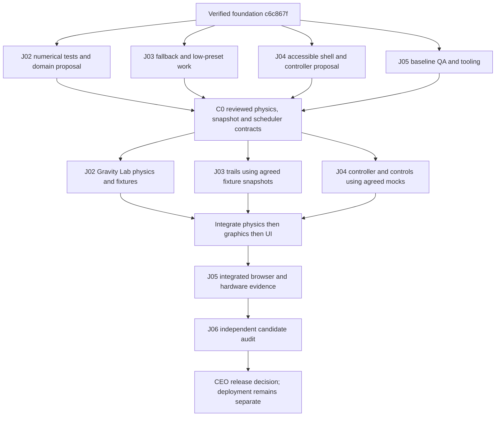

# J07 — Gravity Lab engineering coordination

Status: proposed execution plan; documentation only. Prepared 2026-10-21 (Asia/Jakarta).
Repository: https://github.com/rafeey7/cosmos-lab

## 1. Verified starting point

- Remote `main`, `j02-physics`, `j03-graphics`, `j04-product-ui`, `j05-qa` and `j06-audit` all pointed to `c6c867f95ddae34fb3ada997becc8dd87eaf3e12` at inspection. Local working tree was clean.
- Issues [J02 #1](https://github.com/rafeey7/cosmos-lab/issues/1), [J03 #2](https://github.com/rafeey7/cosmos-lab/issues/2), [J04 #3](https://github.com/rafeey7/cosmos-lab/issues/3), [J05 #4](https://github.com/rafeey7/cosmos-lab/issues/4) and [J06 #5](https://github.com/rafeey7/cosmos-lab/issues/5) were open, unassigned and had no comments. Their bodies agree with the versioned specs. Their historical foundation link points to `643a307`; the subsequent CI-only commit is `c6c867f`.
- No PRs were returned by the repository-wide PR search before J07. This observation is a snapshot, not an assertion about future work.
- [Main CI run 39526913029](https://github.com/rafeey7/cosmos-lab/actions/runs/39526913029), job `118983615450`, completed successfully: frozen install, import boundary, physics-only compilation, Vitest and build. Foundation suite: 16 tests in two files. This is foundation evidence, not MVP certification.
- GitHub branch metadata reported `main.protected = false`. Required reviews/checks are therefore a proposed policy, not a verified enforcement setting. J07 does not alter repository settings.
- Current application advances a synthetic binary by 60 s per click. No continuous runner, solar scenario controls, gravity-off mode or orbital trails exist. `GravityConfig` rejects G <= 0; positive masses and exactly two bodies are required.
- J07 has not launched worker sessions. Model assignments below are requested assignments, not execution claims.

Read [AGENTS](../AGENTS.md), [architecture](architecture.md), [physics assumptions](physics-assumptions.md) and [task index](tasks/README.md) before implementation. Existing issues and task specs remain the source of truth. This plan adds coordination and proposed MVP acceptance; it does not mark any original criterion complete or silently replace it. Any mismatch must be reconciled in a reviewed task-spec amendment before dependent implementation. Unaffected existing-spec work may continue.

## 2. MVP outcome and scope

Target: an interactive, two-body Sun–Earth educational experiment with numerically integrated trajectories; velocity and solar-mass controls; an explicitly artificial gravity-off experiment; pause/play, single step and reset; accessible data and scientific metrics with or without WebGL2.

Stage A closes existing task criteria against the foundation. Stage B adds the narrow Gravity Lab experiment after contract checkpoint C0 below. Before Stage B code, task owners submit any needed acceptance addenda to their versioned spec and link them in their issue/PR; lead review must reconcile the addenda with the original issue. Approval of this coordination PR alone does not make a proposed API implemented. No N-body engine, relativistic model, accounts, backend, high-quality preset, unbounded history, full tutorial suite or deployment is included.

The current user directive authorizes planning the next MVP phase despite the foundation wording in AGENTS. Architecture invariants and all original task criteria continue to apply.

## 3. Ownership and single-writer rules

| Workstream / requested model | Branch | Exclusive implementation ownership | Shared interface authority |
| --- | --- | --- | --- |
| J02 / GPT-6.1 Sol | `j02-physics` | `src/physics/**`, `tests/physics*.test.ts`, numerical fixtures under `tests/fixtures/physics/**`, physics assumptions | `Body`, `TwoBodyState`, `GravityConfig`, engine/failure/scenario/diagnostic exports |
| J03 / Claude Sonnet 5.5 | `j03-graphics` | `src/graphics/**`, `tests/graphics/**`, `tests/contracts.test.ts`, render adapter tests | `src/contracts/render.ts`, snapshot and viewport props; no physics edits |
| J04 / Claude Sonnet 5.5 | `j04-product-ui` | `src/App.tsx`, `src/main.tsx`, `src/styles.css`, `index.html`, new `src/ui/**`, `src/simulation/**`, `tests/ui/**`, `tests/simulation/**` | Experiment lifecycle/scheduler controller outside physics; consumes J02/J03 contracts |
| J05 / GPT-6.1 Sol | `j05-qa` | `tests/integration/**`, `tests/e2e/**`, browser-test config, evidence under `docs/qa/**`, `.github/workflows/**` | Sole package/toolchain editor during coordinated changes: `package.json`, lockfile, workspace settings, Vite/TS config |
| J06 / GPT-6 Astra, separate review context | `j06-audit` | `docs/audit/**`, independent review findings | No unilateral production fixes; request a corrective PR from the owner |
| J07 / lead | `j07-engineering-coordination` | This plan and `docs/agent-prompts/**` | Interface decisions, integration schedule and approval log |

Each owner may update its own task spec after review; architecture/README changes need a lead-assigned single editor. The existing task spec allowance for small J06 fixes is preserved, but any code fix must be a separately reviewed PR with owner coordination, not bundled into audit approval.

Before any shared edit, record in the relevant PR: exact paths, writer, consumers, proposed signature/semantics, backward compatibility, tests, base SHA, and completion/expiry condition. Consumers acknowledge; lead assigns one writer. Other agents use mocks/fixtures at the agreed boundary. No simultaneous writes, copying unmerged implementations, force-pushing another agent's branch, or resolving a conflict by overwriting the other side. Package additions from J03/J04 are requests to J05, who lands one small tooling PR; agents can continue implementation-independent work meanwhile.

## 4. Dependency map and contract checkpoint C0

C0 is a review checkpoint, not a new runtime framework. J02 publishes physics proposals, J03 publishes render proposals, J04 publishes controller semantics, J05 provides test cases. Freeze a versioned written agreement before any consumer relies on new fields. Each owner's contract PR carries tests; its own existing contract remains valid until that PR is accepted and merged by an authorized maintainer.

Recommended semantics to resolve at C0 (proposals, not existing APIs):

1. **Physical state:** retain immutable SI tuples, exactly two positive masses, stable IDs and synchronized position/velocity time. Use an inertial barycentric Sun–Earth fixture; do not silently pin the Sun. J02 chooses sourced constants and publishes the supported parameter/dt domain. UI display multipliers must convert to explicit kg and m/s before calling the engine.
2. **Gravity disabled:** prefer an explicit, default-enabled interaction switch rather than setting solar mass or G to zero. The disabled mode has zero pair acceleration for both bodies and ballistic motion while retaining positive masses. Preserve position/velocity at the switch boundary. Potential-energy diagnostics must match the selected force law. This is an artificial removal of the two-body interaction, not a physical solar-disappearance model. J02 must decide and test separation-guard semantics in the disabled mode; no renderer/UI workaround is allowed.
3. **Parameter application:** velocity/solar-mass edits are validated drafts; Apply constructs a new paused initial condition and increments an experiment epoch. It clears trails and diagnostic baselines. Reject invalid values without corrupting the previous run. Recommended velocity control is tangential initial Earth velocity relative to the Sun, with J02 rebuilding barycentric velocities; units/frame must be visible. Mass changes must not secretly renormalize the user's chosen velocity.
4. **Interventions:** a gravity toggle pauses, applies at an exact step boundary, retains current state and time, and starts a new diagnostic segment. Keep trajectory continuity but mark the intervention. Conservation errors are measured within a constant-force segment; do not describe the instantaneous energy change from an external intervention as integrator drift. Reset restores the last explicitly applied initial parameters, gravity enabled, t=0 and paused state. A separate default-preset action may restore canonical Sun–Earth parameters.
5. **Scheduler:** J04 owns a fixed-dt accumulator outside physics. Recommended caps: <=8 physics substeps per animation frame, <=250 ms wall-clock delta admitted per frame, finite documented time-scale. dt is chosen from J02's supported domain and stays fixed during a run. Drop excess catch-up time with a visible slower-than-requested indication; never enlarge dt to catch up. Pause on hidden tab, clear accumulator/clock on pause/reset, and require explicit resume. Step is enabled only while paused and advances exactly one accepted dt. On any numerical failure, keep the last successful step, pause and announce the cause. Repeated Play must not create duplicate loops.
6. **Publishing state:** scheduler keeps authoritative state outside per-frame React updates. Publish immutable view/metrics snapshots at a bounded rate (proposed <=10 Hz), and synchronously on Step/Reset/Apply/error. J03 owns graphics-side invalidation/interpolation policy. Renderers never advance physics; interpolation, if used, is explicitly visual only. J04 supplies the experiment epoch via an agreed wrapper or viewport prop; it is not a new physical coordinate.
7. **Trails:** J03 owns a <=256-point ring buffer per body. Sample by simulation-time policy, not screen frames; pause does not append duplicates. Epoch change resets trails; a gravity event marks a new segment without losing the existing path. Rendering positions and trails use the same scale and origin. No mutation or retention of an unbounded chain of physics snapshots.
8. **Failure and diagnostics:** J02 proposes structured, serializable failure categories while preserving compatibility with existing RangeError callers or providing a tested adapter. Publish separation, relative speed, kinetic/potential/total energy, angular momentum, barycentre and a clearly defined error baseline. J04 must show units and unavailable/not-applicable states, never invented zeroes. No conservation guarantee across mass/velocity edits or force-law switches.

C0 exit evidence: reviewed signatures and examples for initial run, one step, invalid input, reset, force toggle and close encounter; ownership list; migration/compatibility tests; documented numeric parameter ranges and dt; explicit lead/consumer acknowledgements. No agent may assume another has approved by silence.

## 5. Parallel schedule and merge policy

Schedule is dependency-based, not an unsubstantiated time estimate.

| Wave | Work allowed concurrently | Must wait |
| --- | --- | --- |
| 0 — baseline | Each agent reads source/specs and runs baseline checks in its own checkout. J05 prepares QA matrix; J06 may independently inspect the foundation. | New shared APIs and MVP certification |
| 1 — existing specs / C0 | J02 analytic tests/domain proposal; J03 capability/fallback tests and bounded-trail design; J04 accessible shell/step/reset tests and scheduler proposal; J05 tooling PR and baseline browser checks | New force-mode consumers and continuous controller integration |
| 2 — contracts accepted | J02 experiment implementation; J03 render/trails against frozen fixtures; J04 controls/controller against frozen mocks; J05 writes cross-boundary tests | Final integration assertions until actual producers land |
| 3 — integration | Sequential landing of dependencies; J05 tests actual candidate; owners fix only their areas | J06 final sign-off until candidate and evidence are complete |
| 4 — audit | J06 audits exact candidate SHA; owners prepare focused corrections | Release/deploy until explicit authorization and all blocking gates pass |

Recommended merge order, each merge requiring explicit maintainer authorization: J07 docs -> J05 minimal shared tooling (only if needed) -> owner-authored C0 contract/spec PRs in producer-before-consumer order -> J02 physics -> J03 graphics -> J04 UI/controller -> J05 integrated QA/CI -> J06 audit documentation. Existing-contract-only fixes can land earlier after independent checks; they must not break the agreed sequence for new interfaces. Split a task into successive focused PRs on its assigned branch; never have two writers on that branch.

All implementation goes through PRs targeting `main`. Use `j02-physics`, `j03-graphics`, `j04-product-ui`, `j05-qa`, `j06-audit`; branch existence is not permission to overwrite existing commits. Each session needs an isolated checkout/worktree. Read remote history and existing PRs before beginning. Record dependency PR URLs and whether they are proposed, approved or merged. Use draft PRs until prerequisites and evidence are ready. No automatic merge or direct feature commits to main.

After each authorized merge, downstream owners fetch main, merge it into their own branch without rewriting published history, and rerun relevant tests plus all required commands. For a conflict: pause affected files, list both intents and paths, ask the designated owner/lead to resolve the semantic choice, preserve both changes where compatible, inspect the resolution and rerun contract/integration tests. Stale green CI is invalid after a changed head. If a merged change regresses main, stop dependent merges and prepare a focused fix or revert PR; do not force-reset main.

Recommended GitHub ruleset, subject to repository-owner decision: PR-only main updates, required `CI / verify`, at least one independent human/lead review, resolved discussions, up-to-date branch or merge queue, and blocked force pushes/deletions. Forbid bypass as normal workflow. J07 does not claim these settings are active. Until configured, the procedural merge gate still applies, but it is not technical enforcement.

## 6. Measurable release gates

The following are acceptance targets, not measured results. Preserve existing thresholds. J02/J05 must propose justified threshold changes before running acceptance; never weaken a test simply to pass. J06 reviews both the derivation and evidence. Numerical thresholds use declared characteristic length L, speed V, mass M and time scale; avoid division by near-zero conserved quantities.

| Gate | Candidate acceptance and required evidence | Owner / verifier |
| --- | --- | --- |
| Numerical baseline | Existing 16 tests pass; circular relative energy max <1e-8 over 10 periods at 1000 steps/period; analytic circular convergence ratio 3.8–4.2 at 200/400 steps; existing unequal-mass momentum tolerance retained | J02 / J06 |
| Eccentric accuracy | Proposed fixtures e=0.1 and e=0.6, one period at dt=T/10000; max position error/L <=1e-4 against an independent Kepler reference, max relative energy error <=1e-6. Report reference solver residual <=1e-12 and worst-case errors. Halved-dt error ratio 3.5–4.5 where truncation error dominates | J02 / J06 |
| Conservation/reversal | For noncolliding constant-force fixtures, normalized angular-momentum drift <=1e-10 and barycentre error relative to its predicted uniform motion <=1e-10; forward N steps, reverse velocities, forward N positive-dt steps returns positions and negated original velocities within 1e-9 normalized error (N=1000). Document scales and rounding limits | J02 / J06 |
| Force-off and domain | After toggle, x(t)=x0+v0*t and constant velocity within declared floating-point tolerance (target normalized error <=1e-10 over 1000 steps). Test invalid/overflow/threshold-equality and between-step close encounters. Unsupported states stop explicitly, preserve last valid state and do not silently soften forces | J02 + J04 / J05 |
| Interactive behavior | Play/pause/step/reset/apply and force-toggle pass automated tests; 30/60/120 Hz mocked clocks produce the same accepted-step sequence absent overload; substep limit <=8; hidden-tab pause, no duplicate loop, no React per-frame state stream; slower-than-requested state observable under overload | J04 / J05 |
| Browser compatibility | Production build tested on current stable Chrome, Edge and Firefox on Windows, recording exact versions; 360px and 1280x720 layouts; normal WebGL2, disabled/unavailable WebGL2, initialization error and forced context loss. Core controls/data work in all fallback cases, no uncaught exceptions or infinite loading | J03 + J04 / J05 |
| Graphics performance | Representative Intel UHD/8GB, exact CPU/GPU/driver/browser/power mode, 1280x720 DPR1 low, two bodies and 256 trail points each. After 30 s warmup, >=30 fps in every 10 s window over a 60 s active run; report p50/p95 frame times and stalls. Paused unchanged scene submits no continuing frames after settling (sample 10 s). Repeat three times, report all runs | J03 / J05 |
| Resource budget | Bounded trails <=256/body verified in long run. Three 10-minute target-hardware runs, post-warmup tab/process memory growth from minute 2 to minute 10 <=50 MiB; report samples, peak and measurement method, investigate monotonic growth. Total compressed JS loaded for baseline low view <=400 kB gzip; larger justified change blocks the budget gate pending review. No hidden heavy assets | J03 / J05 |
| Accessibility | Complete controls by keyboard, visible focus, accessible names and SI units, announced errors, no focus trap, reduced-motion-compatible pause. At 360px and 200% zoom no page-wide horizontal scrolling; SI table may scroll in a labelled region. Automated accessibility scan has zero serious/critical violations; manual checks cover items automation misses | J04 / J05 |
| Production/reliability | Clean Node24/pnpm11.25 frozen install, `pnpm check`, physics-only compile, new interaction/browser suites and CI green for exact candidate SHA. Zero unexplained failures; dependency/license audit includes dev tooling, no unreviewed high/critical runtime advisory. Build warning disposition recorded. Deployment dry-run instructions only | J05 / J06 |
| Scientific transparency | Visible model/frame/units, constants with sources, fixed dt/time-scale, illustrative body sizes, Newtonian/point-mass limits, interaction mode, intervention markers and diagnostic segment semantics; no claim of measured ephemerides or conservation across interventions | J02 + J04 / J06 |

Release requires all blocking gates PASS, no unresolved critical/high audit findings, and explicit CEO release authorization. A gate with missing hardware, unsupported browser evidence or an unapproved threshold is NOT RUN/BLOCKED, never PASS. Proposed budgets are engineering recommendations for review; failed evidence must lead to a fix or an explicitly documented acceptance decision, not a fabricated benchmark.

Evidence record per gate: candidate SHA; date/timezone; owner/tester and actual tool/model where known; exact command/procedure; OS/browser/GPU/driver; fixture and parameter/dt values; expected vs observed numbers; PASS/FAIL/NOT RUN; logs/screenshots/artifact path; issue for each residual risk. J05 publishes `docs/qa/release-candidate.md`; J06 publishes `docs/audit/release-readiness.md` against that same SHA. Any candidate code change invalidates affected evidence and requires targeted reruns plus final CI.

## 7. Execution packets and launch readiness

- [J02 Physics execution prompt](agent-prompts/J02-physics.md)
- [J03 Graphics execution prompt](agent-prompts/J03-graphics.md)
- [J04 Product UI execution prompt](agent-prompts/J04-product-ui.md)
- [J05 QA execution prompt](agent-prompts/J05-qa.md)

These files are standalone instructions to paste into actual worker sessions. No sessions were launched by preparing them. GPT-6.1 Sol and GPT-6 Astra are exposed as options in this environment's agent tooling; Claude Sonnet 5.5 is not an exposed model option here. This is a tooling observation, not a claim about another application's availability. Launch J03/J04 in an actual Claude-capable environment, or obtain CEO approval for a named substitute. Do not silently substitute a model or claim the requested model ran. This J07 chat does not assert its own requested Astra identity.

J06 handoff: start a separate review context on `j06-audit`, read issue #5 and its versioned spec, the exact candidate diff and J05 evidence; independently challenge physics, architecture, dependencies, scientific claims and resource bounds. Report findings with severity, file/line, reproduction, impact, owner and release effect. Missing evidence blocks the relevant gate; developer self-review is not independent sign-off. Do not merge, deploy or close the audit on incomplete evidence.

Required decisions/resources before dependent work:

1. **Dispatch:** CEO/operator supplies Claude-capable sessions for J03/J04 or explicitly selects replacements. Until then, prompts are ready but those assignments are not running. This does not block preparation by other owners.
2. **Contract review:** lead plus J02/J03/J04 accept C0, parameter/dt ranges and corresponding task-spec addenda. This is an engineering checkpoint; escalate to CEO only if it changes product scope.
3. **Main enforcement:** repository owner approves/enables the proposed ruleset, or explicitly accepts procedural-only integration controls. Do not represent unprotected main as enforced stable.
4. **Hardware:** assign a tester with representative Intel UHD and 8GB for J05. No target-hardware pass before actual measurements.
5. **Release:** after J06 evidence, CEO decides readiness and separately authorizes deployment. No hosting choice or deploy action is needed for J07.

## 8. PR and report contract

Every work PR links its issue and versioned spec, states base/head SHA, lists owned/shared files and dependency PRs, describes observed behavior and compatibility, includes exact validation results and artifacts, and lists not-run checks/blockers. Use `Refs #N` until all issue criteria are satisfied; do not auto-close the issue after only an initial slice. Do not merge or deploy from a worker prompt.

Each agent's final report must use these fields: task/model actually used (or unverified); branch and head SHA; PR URL; changes and owned paths; contract changes and review reference; dependency status; command/results; quantitative scientific/performance evidence; checks not run; findings/risks; next owner/action. Never turn a plan, test stub or CI configuration into a claim of executed success.
